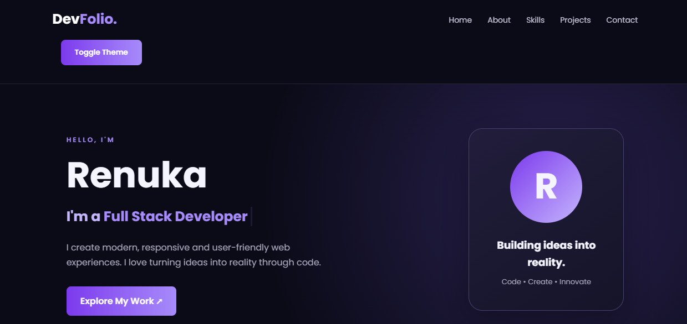
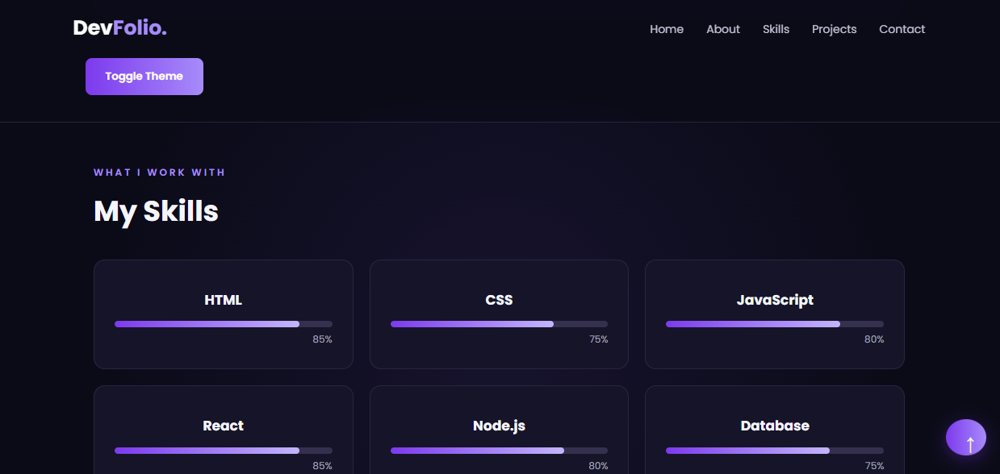
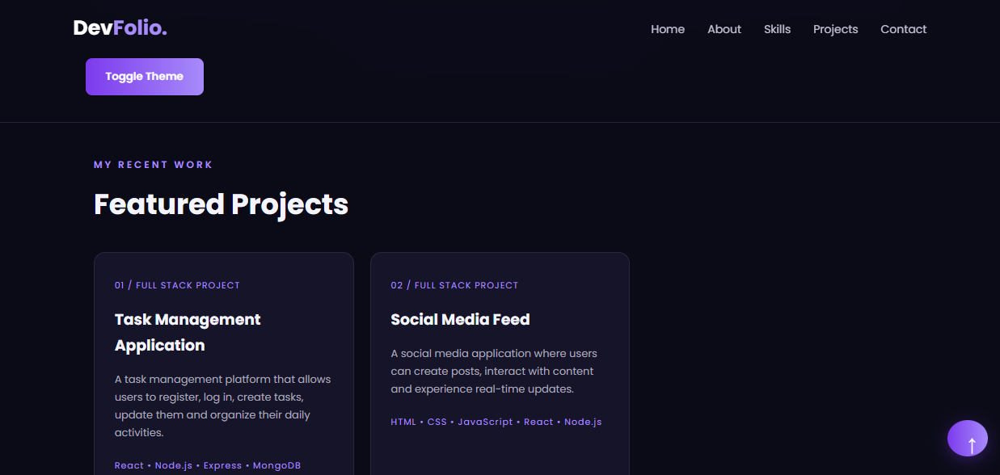
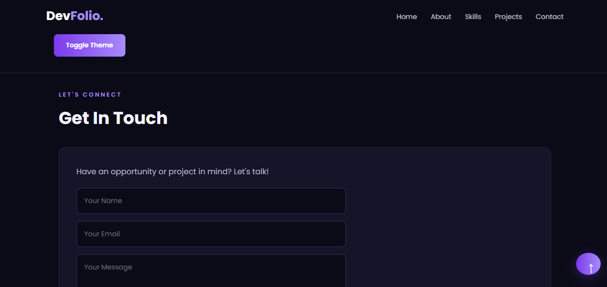

# DevFolio – Personal Developer Portfolio

## About the Project

DevFolio is a responsive personal portfolio website developed to showcase my skills, projects, and background as a Computer Science student interested in full-stack development.

## Technologies Used

- HTML5
- CSS3
- JavaScript (ES6)

## Features

- Modern and responsive design
- Home, About, Skills, Projects, and Contact sections
- Dark and light theme toggle
- Contact form validation
- Smooth scrolling
- Skill progress bars
- Back-to-top button
- Mobile-friendly layout

## Project Structure

```text
devfolio/
├── index.html
├── style.css
├── script.js
├── README.md
└── screenshots/
    ├── home.png
    ├── about-skills.png
    ├── projects.png
    └── contact.png
```

## Screenshots

### Home


### About and Skills


### Projects


### Contact


## Live Website

[View Live Portfolio](https://immadirenuka.github.io/devfolio-portfolio/)

## GitHub Repository

[View GitHub Repository](https://github.com/ImmadiRenuka/devfolio-portfolio)

## How to Run Locally

1. Download or clone this repository.
2. Open the project folder in VS Code.
3. Open `index.html` in a web browser.

## Developer

Renuka Immadi